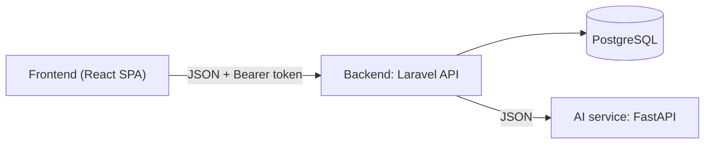

# Onboarding

Mục tiêu: trong 15 phút bạn chạy được dự án và biết cần đọc gì. Phần còn
lại là tài liệu tra cứu, không cần đọc hết ngay.

## 1. Dự án là gì

TROSV - website tìm phòng trọ gần trường cho sinh viên: duyệt phòng trên
bản đồ, yêu thích, nhắn tin trực tiếp với chủ trọ (kèm tệp đính kèm),
đánh giá, và các gợi ý AI (khu vực, bạn cùng phòng, trợ lý chat).



Ba nguyên tắc: Frontend **chỉ** gọi Backend · AI service không chạm
database · file hợp đồng trong `docs/` là nguồn sự thật - đổi gì phải sửa
hợp đồng trước, rồi báo cả nhóm.

## 2. Chạy local

Cần Docker (hoặc Podman) trên Debian:

```bash
cp .env.example .env     # điền APP_KEY (lệnh tạo có sẵn trong file)
docker compose up -d --build
```

- Web: http://localhost:3000 · API: http://localhost:3000/api
- Dữ liệu demo: `SEED_ON_BOOT=1` trong `.env` (đặt trước khi boot), hoặc
  `docker compose exec backend php artisan migrate:fresh --seed --force`
- Tài khoản demo (mật khẩu `password`): `student1@trosv.vn` (sinh
  viên), `landlord1@trosv.vn` (chủ nhà)
- AI service là stub FAKE_MODE, không bắt buộc: `docker compose --profile
  ai up -d`. AI tắt thì backend tự trả 503, mọi tính năng còn lại chạy bình thường.

Chạy không Docker (PHP + Node trực tiếp): `bash infra/deploy/deploy.sh` (lần sau thêm
`--quick`).

Smoke nhanh API: `bash scripts/e2e-smoke.sh` - xanh là đủ để bắt đầu code.

## 3. Đọc gì tiếp theo, theo vai trò

| Vai trò | Bắt buộc | Tham khảo khi cần |
|---|---|---|
| Mọi người | [README.md](../README.md) | [docs/reports/PLAN.md](reports/PLAN.md), [docs/reports/TECH-DEBT.md](reports/TECH-DEBT.md) |
| Backend | [docs/contracts/API_CONTRACT.md](contracts/API_CONTRACT.md) + [docs/contracts/ERD.md](contracts/ERD.md) | - |
| Frontend | [docs/contracts/API_CONTRACT.md](contracts/API_CONTRACT.md) + [apps/web/README.md](../apps/web/README.md) | [docs/reports/TECH-DEBT.md](reports/TECH-DEBT.md) |
| AI | [docs/contracts/AI_CONTRACT.md](contracts/AI_CONTRACT.md) | [docs/contracts/ERD.md](contracts/ERD.md) |
| Triển khai | [docs/runbooks/DEPLOY.md](runbooks/DEPLOY.md) | [SECURITY.md](../SECURITY.md), [infra/backup/RESTORE.md](../infra/backup/RESTORE.md), [docs/runbooks/ROLLBACK.md](runbooks/ROLLBACK.md) |

## 4. Quy ước bắt buộc

- **Hợp đồng API trước tiên**: shape JSON, mã lỗi, message tiếng Việt phải
  khớp `docs/contracts/API_CONTRACT.md`. Người ngoài bị chặn nhận **404** (không lộ
  tồn tại), lỗi validation luôn 422 `{ message, errors }`.
- **Mass assignment**: không bao giờ cho `role` qua request; field sinh
  viên/chủ nhà phân tách bằng FormRequest riêng theo vai trò.
- **Test trước khi push**: backend `php artisan test` + `./vendor/bin/pint
  --test`; frontend `npm run lint && npm run build`. CI cả 4 job phải xanh.
- **Commit**: conventional, tiếng Việt không dấu, gọn một dòng ý nghĩa.
- **Không commit secret**: `.env` đã ignore; CI có job gitleaks quét mỗi push.

## 5. Bản đồ thư mục

```
apps/api/   Laravel API
  app/Modules/<Module>/    mỗi domain một module: Models, Http/{Controllers,Requests,Resources},
                           Policies, Events, Services, routes.php (Auth, Reference, Listing,
                           Favorite, Messaging, Ai)
  app/Shared/              Controller gốc, middleware (role, throttle, security headers), Support (Geo, StoragePath)
  routes/api.php           /health + nạp app/Modules/*/routes.php
  tests/Feature/<Module>/  210+ test theo module, gồm ma trận phân quyền (Shared/)
apps/web/   React 18 + TypeScript strict SPA (Vite 6, Tailwind CSS v4, Radix UI, Leaflet)
  src/features/            mỗi domain một thư mục (auth, listings, search, room, favorites,
                           landlord, messaging, profile, ai): pages/ components/ hooks/ api/ lib/
  src/shared/              ui (design system), layout (shell), api (axios), hooks, lib, constants
  src/app/                 router, providers, error boundary
  src/styles.css           Tailwind CSS v4 + design tokens (màu sắc, typography, shadow)
apps/ai-service/ FastAPI (stub FAKE_MODE)
  app/features/<name>/     router, schemas, heuristics (rule-based), gemini (LLM) cho tung endpoint
  app/shared/              Gemini client, guard_fake (503), BaseReq
docs/       contracts/, architecture/, reports/, runbooks/, ONBOARDING.md
infra/      docker/, deploy/, backup/
scripts/    cong cu no ky thuat & dev helpers
```

Sửa gì cũng nhớ: hợp đồng trước, code sau, test kèm theo.
